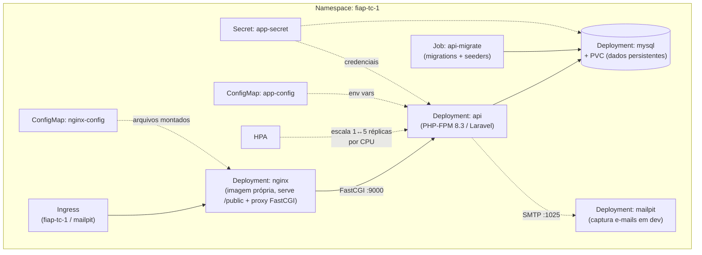
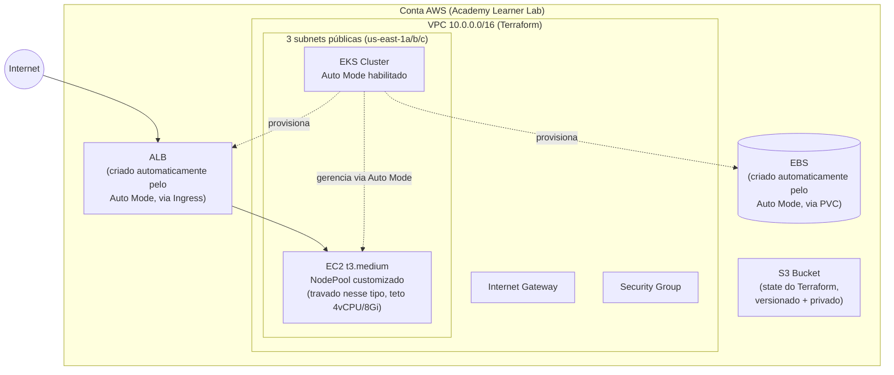
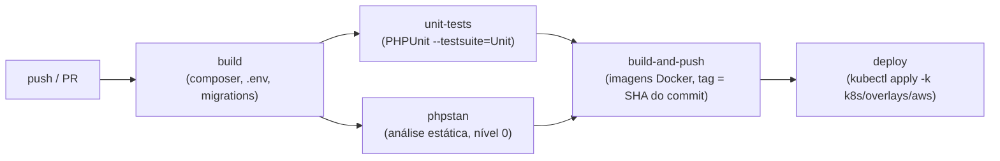

# Infraestrutura — Kubernetes, Terraform e CI/CD

Este documento cobre a infraestrutura do projeto: como a aplicação foi containerizada, como ela roda em Kubernetes (local e AWS), como a infraestrutura da AWS é provisionada via Terraform, e como o pipeline de CI/CD conecta tudo isso.

O Terraform deste projeto não vive mais neste repositório — foi dividido em dois repositórios irmãos: [`infra-k8s`](https://github.com/FIAP-TC/infra-k8s) (cluster e rede) e [`infra-db`](https://github.com/FIAP-TC/infra-db) (banco de dados RDS). Veja a seção [Terraform](#terraform) abaixo.

## Índice

- [Arquitetura](#arquitetura)
  - [Componentes da aplicação](#componentes-da-aplicação)
  - [Infraestrutura provisionada](#infraestrutura-provisionada)
  - [Fluxo de deploy](#fluxo-de-deploy)
- [Terraform](#terraform)
  - [Como aplicar](#como-aplicar)
- [Instruções: execução local](#instruções-execução-local)
- [Instruções: deploy em Kubernetes](#instruções-deploy-em-kubernetes)
- [Instruções: provisionamento da infraestrutura com Terraform](#instruções-provisionamento-da-infraestrutura-com-terraform)

---

## Arquitetura

### Componentes da aplicação

A aplicação roda como um conjunto de recursos Kubernetes dentro do namespace `fiap-tc-1`, definidos em `k8s/base/` (compartilhado entre ambientes) e customizados por `k8s/overlays/local/` ou `k8s/overlays/aws/` via [Kustomize](https://kustomize.io/).



**Componentes:**

| Componente | Papel | Arquivo(s) |
|---|---|---|
| `api` | PHP-FPM 8.3 rodando o Laravel; imagem própria (`docker/php-fmp/Dockerfile`) | `k8s/base/06-api-deployment.yaml`, `07-api-service.yaml` |
| `nginx` | Serve os estáticos do Laravel e repassa `.php` via FastCGI pro `api`; imagem própria (`docker/nginx/Dockerfile`) | `k8s/base/09-nginx-deployment.yaml`, `10-nginx-service.yaml`, `08-nginx-configmap.yaml` |
| `mysql` | Banco de dados **só no overlay `local`**; `Deployment` com `strategy: Recreate` (evita dois Pods montando o mesmo PVC). No overlay `aws`, esse Deployment e Service são removidos via patch (`$patch: delete`) e a API conecta direto na instância RDS do `infra-db` | `k8s/base/04-mysql-deployment.yaml`, `03-mysql-pvc.yaml`, `05-mysql-service.yaml`; exclusão em `k8s/overlays/aws/delete-mysql-deployment.yaml` e `delete-mysql-service.yaml` |
| `mailpit` | Captura e-mails enviados em dev, sem entregar de verdade | `k8s/base/12-mailpit-deployment.yaml`, `13-mailpit-service.yaml` |
| `api-migrate` | `Job` que roda `php artisan migrate --seed --force`; tem um `initContainer` que espera o MySQL responder antes de rodar | `k8s/base/15-api-migrate-job.yaml` |
| `HPA` | Escala o Deployment `api` entre 1 e 5 réplicas, alvo de 50% de uso de CPU | `k8s/base/11-api-hpa.yaml` |
| `Ingress` | Roteamento HTTP externo, por host (`app` vs `mailpit`) | `k8s/base/14-ingress.yaml` + patch no overlay AWS |
| `ConfigMap`/`Secret` | Configuração e credenciais, injetadas via `envFrom`. No overlay `aws`, o `DB_HOST` é sobrescrito via `configMapGenerator` lendo `k8s/overlays/aws/db-host.env` (gerado a cada deploy, não versionado) | `k8s/base/01-configmap.yaml`, `02-secret.yaml` (não versionado, veja `.example`) |

### Infraestrutura provisionada



**O que é criado por quem:**

- **Terraform**, no repositório [`infra-k8s`](https://github.com/FIAP-TC/infra-k8s), cria: VPC, subnets, Internet Gateway, route table, Security Group do cluster, o cluster EKS em si, os *access entries* que permitem autenticação via `kubectl`, e o bucket S3 do state.
- **Terraform**, no repositório [`infra-db`](https://github.com/FIAP-TC/infra-db), cria a instância **RDS MySQL**, seu próprio Security Group (libera a porta 3306 só pro Security Group do cluster) e o DB Subnet Group — reaproveitando a VPC/subnets do `infra-k8s` via `terraform_remote_state` (lido do mesmo bucket S3), sem criar rede própria.
- **EKS Auto Mode** (não o Terraform) cria, em resposta a objetos do Kubernetes: as instâncias EC2 (via `NodePool`/`NodeClass`), o **ALB** (via `Ingress`), e os volumes **EBS** (via `PersistentVolumeClaim`). Por isso alguns recursos AWS "aparecem" sem estar no `terraform state` — eles são gerenciados pelo Kubernetes, não pelo Terraform.
- Não usamos **EBS CSI driver**/**AWS Load Balancer Controller** manuais — o Auto Mode do EKS já resolve storage e load balancing nativamente. O banco de dados usa **RDS** gerenciado (não roda dentro do cluster) no overlay `aws`; no overlay `local`, continua sendo um `Deployment` de MySQL dentro do próprio cluster.

### Fluxo de deploy



O deploy só acontece se **todas** as etapas anteriores passarem (`needs:` no GitHub Actions). Veja detalhes em [`.github/workflows/app.yml`](../.github/workflows/app.yml).

---

## Terraform

O provisionamento da infraestrutura AWS vive em dois repositórios irmãos, clonados lado a lado com este:

| Repositório | Provisiona |
|---|---|
| [`infra-k8s`](https://github.com/FIAP-TC/infra-k8s) | VPC, subnets, Internet Gateway, route table, Security Group do cluster, EKS (Auto Mode), *access entries* pro `kubectl`, bucket S3 do state |
| [`infra-db`](https://github.com/FIAP-TC/infra-db) | Instância RDS MySQL, seu Security Group (libera só o SG do cluster do `infra-k8s`) e DB Subnet Group, lendo a rede do `infra-k8s` via `terraform_remote_state` |

Essa separação é deliberada: infraestrutura de rede/cluster muda raramente e é sensível, o banco é um componente independente que pode ser recriado sem derrubar o cluster, e a aplicação (este repositório) muda o tempo todo — misturar os três num repo só dificultaria revisão e controle de acesso.

**Importante:** nenhum dos dois repositórios de infra gerencia os manifestos Kubernetes da aplicação — isso é responsabilidade do `k8s/` + Kustomize, aqui mesmo.

Valores específicos de cada conta AWS Academy (nome do bucket de state, IAM Roles, ARN de acesso via `kubectl`, senha do banco) estão documentados nos READMEs de cada repositório, nas seções "Adaptando pra uma conta AWS diferente" — não duplicados aqui.

### Como aplicar

Siga essa ordem — `infra-db` lê o state do `infra-k8s` pra saber a VPC/subnets/Security Group do cluster, então precisa que ele já esteja aplicado:

```bash
# 1. infra-k8s — veja o README do repo pro bootstrap do bucket, se for a primeira vez nessa conta
cd ../infra-k8s/terraform
terraform init
terraform apply

# 2. infra-db — só depois do infra-k8s aplicado
cd ../../infra-db/terraform
terraform init
terraform apply -var-file="secrets.tfvars"
```

Veja o passo a passo completo (incluindo os objetos Kubernetes e o `db-host.env`) em [Instruções: provisionamento da infraestrutura com Terraform](#instruções-provisionamento-da-infraestrutura-com-terraform).

---

## Instruções: execução local

Pra desenvolvimento do dia a dia (edição de código com resultado imediato), use **Docker Compose** — não Kubernetes. Kubernetes serve pra validar comportamento de produção (réplicas, autoscaling, rolling update), não pra iteração rápida de código, já que a imagem precisa ser rebuildada a cada mudança.

```bash
cp .env.example .env
docker compose up -d
docker compose exec api php artisan key:generate
docker compose exec api php artisan migrate --seed
```

A API fica disponível em `http://localhost:9000`, o Mailpit em `http://localhost:8025`.

Pra rodar os testes localmente:

```bash
docker compose exec api vendor/bin/phpunit
docker compose exec api vendor/bin/phpstan analyse
```

---

## Instruções: deploy em Kubernetes

### Cluster local (Docker Desktop)

Pré-requisito: Docker Desktop com Kubernetes habilitado.

```bash
kubectl config use-context docker-desktop
kubectl apply -k k8s/overlays/local
kubectl get all -n fiap-tc-1
```

Acesso: `http://fiap-tc-1.localtest.me:9080/api/test` (o Ingress local usa `cloud-provider-kind` pra simular um LoadBalancer).

### Cluster na AWS

Pré-requisito: o cluster (`infra-k8s`) e o banco (`infra-db`) já terem sido criados via Terraform (veja [Terraform](#terraform) acima).

```bash
aws eks update-kubeconfig --name eks-fiap-tc-1-terraform-backend --region us-east-1 --alias eks-fiap-tc-1
kubectl config use-context eks-fiap-tc-1

# gera o DB_HOST a partir do endpoint atual do RDS (muda a cada provisionamento do infra-db, por isso não é versionado)
echo "DB_HOST=$(terraform -chdir=../infra-db/terraform output -raw rds_endpoint)" > k8s/overlays/aws/db-host.env

kubectl apply -k k8s/overlays/aws
kubectl get all -n fiap-tc-1
```

Acesso: pegue o endereço do ALB e use o cabeçalho `Host` correto (sem domínio próprio configurado ainda):

```bash
ALB=$(kubectl get ingress fiap-tc-1 -n fiap-tc-1 -o jsonpath='{.status.loadBalancer.ingress[0].hostname}')
curl -H "Host: fiap-tc-1.localtest.me" "http://$ALB/api/test"
```

### Comandos úteis

```bash
# Remover tudo (namespace inteiro)
kubectl delete namespace fiap-tc-1

# Restartar um Deployment (sem apagar nada)
kubectl rollout restart deployment/<nome> -n fiap-tc-1

# Rodar/re-rodar as migrations manualmente
kubectl delete job api-migrate -n fiap-tc-1 --ignore-not-found=true
kubectl apply -k k8s/overlays/<local|aws>
```

---

## Instruções: provisionamento da infraestrutura com Terraform

1. **Pré-requisitos:** `terraform`, `aws` CLI autenticado (conta AWS Academy — credenciais temporárias, expiram por sessão de laboratório). Clone [`infra-k8s`](https://github.com/FIAP-TC/infra-k8s) e [`infra-db`](https://github.com/FIAP-TC/infra-db) lado a lado com este repositório (mesma pasta pai).

2. **Aplicar o `infra-k8s` primeiro** (veja o README do repo pro bootstrap do bucket, se for a primeira vez nessa conta):

   ```bash
   cd ../infra-k8s/terraform
   terraform init
   terraform apply
   ```

3. **Aplicar o `infra-db`** (precisa dos outputs do `infra-k8s` já aplicado — `vpc_id`, `subnet_id`, `cluster_sg_id`):

   ```bash
   cd ../../infra-db/terraform
   terraform init
   terraform apply -var-file="secrets.tfvars"
   ```

4. **Conectar o `kubectl` ao cluster recém-criado:**

   ```bash
   aws eks update-kubeconfig --name eks-fiap-tc-1-terraform-backend --region us-east-1 --alias eks-fiap-tc-1
   ```

5. **Gerar o `DB_HOST` do overlay `aws`** (volte pra raiz deste repositório), a partir do endpoint atual do RDS:

   ```bash
   cd ../fiap-tc-1
   echo "DB_HOST=$(terraform -chdir=../infra-db/terraform output -raw rds_endpoint)" > k8s/overlays/aws/db-host.env
   ```

6. **Preencher o Secret da aplicação**, se ainda não existir (`k8s/base/02-secret.yaml` é gitignored, nunca vem do clone):

   ```bash
   cp k8s/base/02-secret.yaml.example k8s/base/02-secret.yaml
   ```
   Gere `APP_KEY`/`JWT_SECRET`/`APPROVAL_SECRET` novos (`openssl rand -base64 32`, `-hex 32`, `-hex 16`, respectivamente) e escolha suas próprias senhas de banco — nunca reaproveite os valores de outra pessoa.

7. **Aplicar os objetos Kubernetes que o Auto Mode exige** (não são geridos pelo Terraform — `StorageClass`, `IngressClass`/`IngressClassParams`, `NodePool` customizado — e, junto, toda a aplicação):

   ```bash
   kubectl apply -k k8s/overlays/aws
   ```

8. **Verificar:**

   ```bash
   kubectl get nodes          # deve aparecer 1 instância t3.medium após os Pods serem agendados
   kubectl get pods -n fiap-tc-1
   kubectl get ingress -n fiap-tc-1
   ```

### Desligando pra economizar (sem perder o state)

```bash
kubectl delete -k k8s/overlays/aws                     # deixa o Auto Mode desmontar ALB/EBS antes do cluster sumir
cd ../infra-db/terraform
terraform destroy -var-file="secrets.tfvars"            # derruba o RDS, principal custo do banco
cd ../../infra-k8s/terraform
terraform destroy -target=aws_eks_cluster.cluster       # derruba só o cluster; VPC/subnets/SG/bucket ficam (não custam nada)
```

Pra retomar depois: `terraform apply` no `infra-k8s` (reaproveita a VPC e o Security Group já existentes, recria só o cluster), `terraform apply -var-file="secrets.tfvars"` no `infra-db` (recria o RDS com um endpoint novo), e repita os passos 4 a 7 acima — o `db-host.env` precisa ser gerado de novo porque o endpoint muda a cada criação do banco.

### Via CI/CD (GitHub Actions)

O Terraform de cada repositório de infra tem seu próprio pipeline: `infra-k8s` já tem [`.github/workflows/infra.yml`](https://github.com/FIAP-TC/infra-k8s/blob/main/.github/workflows/infra.yml), que automatiza `plan` (em todo push/PR que toque `terraform/**`) e `apply`/`destroy` sob demanda (`workflow_dispatch`, escolhendo a ação no menu da aba Actions) — nunca aplica/destrói sozinho a partir de um push comum. `infra-db` ainda não tem esse pipeline configurado.

Secrets necessários em cada repositório de infra (`Settings → Secrets and variables → Actions`): `AWS_ACCESS_KEY_ID`, `AWS_SECRET_ACCESS_KEY`, `AWS_SESSION_TOKEN` (credenciais temporárias da sessão ativa do AWS Academy Lab — precisam ser atualizadas a cada nova sessão).
